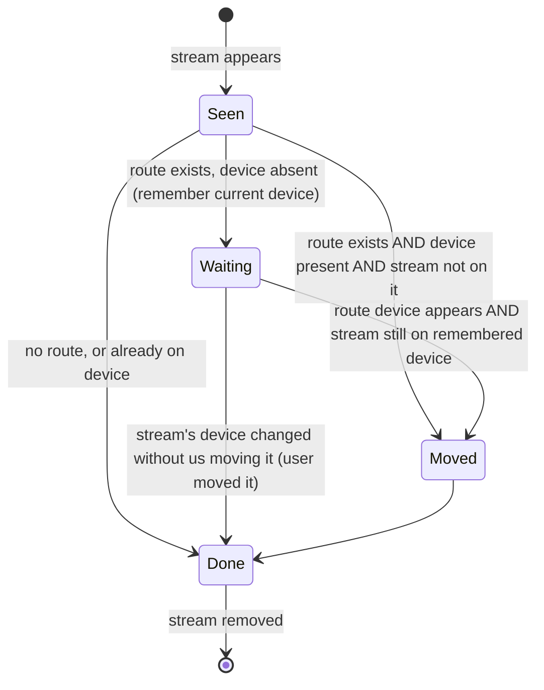
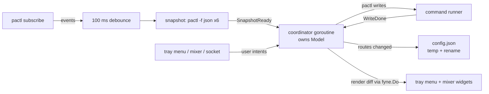

# Audio Indicator — Design

A tray indicator for this machine (Sway + Waybar, PipeWire 1.6.9 + WirePlumber 0.5.18,
pipewire-pulse) that switches the default output/input in two clicks, like
[Sound Switcher Indicator](https://yktoo.com/en/software/sound-switcher-indicator/), and
adds a per-app choice of output and input device that is remembered.

This replaces the current polling/rebuild design. The review in
`.agents/SESSION_REPORT.md` lists the defects that motivate the rewrite.

## 1. What the user gets

| Surface | Opened by | Purpose |
|---|---|---|
| Tray icon | always visible in Waybar `tray` | icon shows output kind + mute state |
| Switcher menu | right-click tray icon | two-click device switching, per-app routes, mute toggles |
| Mixer window | left-click tray icon, Waybar `custom/audio` click, `$mod+Shift+a` | volumes, mutes, per-app pickers, saved routes |
| Preferences | menu → Preferences… | hide/rename devices, edit or delete saved app routes |

### Switcher menu (right-click)

```
Output
  ✓ Jabra Link 390
    Odyssey G5 (HDMI)
Input
  ✓ Jabra Link 390
    Anker PowerConf C200
    Built-in mic
─────────────
Apps
  Google Chrome   ▸  Output ▸ ✓ Follow default │ Jabra Link 390 │ Odyssey G5 (HDMI)
                     Input  ▸ ✓ Follow default │ Jabra Link 390 │ Anker PowerConf C200 │ Built-in mic
  Spotify         ▸  Output ▸ …
─────────────
  Mute output
  Mute microphone
Open mixer…
Preferences…
Quit
```

- One entry per output/input *port*, not per sink: the PCI card exposes HDMI and
  analog headphones on different profiles. Ports already exposed by a device are
  hidden only when `not available`; ports requiring a profile switch are listed
  only when `available`, and selecting one switches the card profile first.
- Monitor sources (`*.monitor`) are never listed. Any device, e.g. the `snd_aloop`
  loopback card, can be hidden in Preferences (`hidden_devices`).
- Apps lists running apps plus apps that have a saved route.

### Mixer window (left-click)

```
 Output  [Jabra Link 390        ▾]   ━━━━━━━●━━━  60%  [mute]
 Input   [Jabra Link 390        ▾]   ━━━━●━━━━━━  40%  [mute]
 ───────────────────────────────────────────────────────
 Apps
  Google Chrome   ━━━━━━━━━●━ 105%  [mute]  Out [Follow default ▾]
                                            In  [Anker C200     ▾]  saved
  Spotify         ━━━━━●━━━━━  50%  [mute]  Out [Odyssey G5     ▾]  saved
 ───────────────────────────────────────────────────────
 Saved routes (not running)
  Firefox         Out → Odyssey G5 (HDMI)                    ✕
```

- One row per app, not per stream. The slider sets every stream of that app.
- `widget.Select` dropdowns replace the expand/collapse button lists.
- `saved` marks a saved route; picking "Follow default" deletes it.
- Saved routes for apps that are not running are listed with a delete button.
- Sliders go to 150% (volume above 100% exists today: Chrome is at 105%).

## 2. Core decisions

| # | Decision | Why |
|---|---|---|
| D1 | One long-running process owns tray + mixer; second invocations talk to it over `$XDG_RUNTIME_DIR/soundquay.sock` (`soundquay toggle`, `show`, `quit`) | Today every Waybar click starts another instance; `launch.sh` PID logic is broken (trap never runs after `exec`, SIGUSR1 is ignored) |
| D2 | Fyne 2.7 tray: `SetSystemTrayMenu` (submenus + checkmarks supported), `SetSystemTrayIcon` with embedded PNGs (Fyne's Linux tray cannot decode SVG), and `fyne.io/systray.SetOnTapped` for left-tap toggle so tray, socket and close button share one visibility state; close button hides the window. The tray icon is the primary indicator; Waybar `custom/audio` stays only as a volume readout/scroll target whose click runs `soundquay toggle` | No new dependency (systray already ships with Fyne); Waybar's tray registers the item (checked on this machine; submenu rendering still to be checked by V4). If the tray is unavailable, the app still runs and the mixer opens via `toggle` |
| D3 | Event-driven: one `pactl subscribe` child; on an event, wait 100 ms for more, then take one snapshot | Replaces ~30 process spawns every 2 s with ~6 spawns per actual change and zero when idle |
| D4 | Snapshots read with `pactl -f json` (`info`, `list sinks`, `list sources`, `list sink-inputs`, `list source-outputs`, `list cards`) | Removes every regex parser; JSON already carries `application.*`, ports, availability, profiles |
| D5 | All writes go through `pactl` (`set-default-*`, `set-card-profile`, `set-*-port`, `move-sink-input`, `move-source-output`, volume/mute). Each command reports its own success or failure to the coordinator; subscribe events only refresh state | Same path on PipeWire and PulseAudio. Hypothesis (V2/V3): on pipewire-pulse a move sets the stream's `target.object`, which WirePlumber honors. If V2/V3 fail, input moves on PipeWire switch to a `pw-metadata -n default <stream id> target.object <node name>` write, enabled only when `pw-metadata` exists |
| D6 | Delete the `pw-cli`/`wpctl inspect` discovery path and the owner-guessing heuristics | Apps are identified only from a stream's own properties; guessing produced wrong labels and wrong preference keys |
| D7 | Saved routes live in `~/.config/soundquay/config.json`, written by temp file + rename from the coordinator only | Visible, editable, deletable; no concurrent writers |
| D8 | Widgets are keyed (device name, app key) and updated in place; the tree is rebuilt only when the set of keys changes | Today a full rebuild every 2 s replaces sliders mid-drag |
| D9 | A slider being dragged, or changed in the last 1 s, ignores incoming snapshot values for that slider only | Replaces the global 3 s grace period that rebuilds bypass |

## 3. Identity

**Device** = `name` of the sink/source (= PipeWire `node.name`), e.g.
`alsa_output.usb-_Jabra_Link_390_6CFBED5C5C34-00.analog-stereo`. Stable across reboots
and replugs (USB names include the serial). Ports are `(card name, port name)`.

**App key**, first non-empty of:
1. `application.id` (Flatpak and portal apps)
2. `application.process.binary`, unless it is a shared runtime
   (`electron`, `python3`, `node`, `java`, `wine*`, `bwrap`)
3. `application.name`

Chrome playback today: `application.name = "Google Chrome"`,
`application.process.binary = "chrome"` → key `chrome`. If Chrome's capture stream
("Google Chrome input") also reports binary `chrome`, playback and capture land in
one row (validation V1).

Display name = `application.name` of the most recent stream for that key.
Streams with no `application.*` properties get key `node:<node.name>` and are shown
under Apps as-is, but routes cannot be saved for them (no stable identity).

**Not apps**: streams with `owner_module != null` or `node.virtual = true`
(loopbacks, echo-cancel, filter-chain internals). If a filter exposes a source
(e.g. echo-cancel), that source is listed as an input device; its own capture stream
is shown under the device, not under Apps.

## 4. Per-app routing rules

```
Route { appKey, displayName, direction: output|input, device: node name }
```

No route = follow the default device.



Rules:
- A route is applied to a stream **once**: when the stream appears, or when its
  device appears later while the stream has not been moved by someone else. A stream
  the user moves elsewhere (pavucontrol, `pactl`) is never pulled back, which avoids
  the 8-second tug-of-war of the current code.
- Choosing a device for an app in the menu/mixer saves the route **and** moves that
  app's live streams now.
- Choosing "Follow default" deletes the route and moves live streams to the default.
- Changing the default device does not touch streams of apps that have a route.
  Streams without a route follow the default via WirePlumber
  (`linking.follow-default-target = true`); this app does not move them.
- WirePlumber's own `restore-target` stays enabled but is not relied on: on stream
  start it may place the stream at a remembered target first; this app then moves it
  to the saved route if it differs. Saved routes win.

`ApplyRoutes(view, routes, tracker) → []Move` is a pure function over the current
state; the coordinator runs the moves and updates the tracker (stream index → state
above). Stream indexes are never persisted. When a saved-route move fails, the
coordinator calls `Tracker.Forget` for that stream, so the next snapshot plans it again.

## 5. Architecture



- The coordinator keeps the existing typed `Msg`/`Cmd` shape. Changes from today:
  the inbox is a mutex-guarded slice plus a 1-slot wake-up channel, so `Dispatch`
  never blocks the Fyne thread and never drops a message (a refresh can no longer
  get stuck "in flight"). Slider changes replace the pending value for that slider
  instead of queueing one message per tick.
- Each write command dispatches its own result (`WriteDone{op, err}`). Write failures
  show a one-line error at the bottom of the mixer and in the log. The new state
  arrives through the next subscribe-triggered snapshot.
- `pactl subscribe` exiting (PipeWire restart) → restart with backoff 0.5 s → 5 s,
  and take a full snapshot after every (re)start.

### Packages

| Path | Contents |
|---|---|
| `internal/pulse` | command runner, JSON types, `Snapshot`, `Subscribe`, write commands |
| `internal/model` | `View` derived from a snapshot + config (switch entries, apps), app key rules, `Route`, `Tracker`, `ApplyRoutes`, config load/save |
| `main` package (`coordinator.go`, `tray.go`, `mixer.go`, `prefs.go`, `instance.go`, `main.go`) | coordinator, Fyne tray menu, mixer window with keyed rows, Preferences window, unix-socket single instance, CLI: no args = run; `toggle`, `show`, `quit`, `snapshot` (prints JSON) |

Removed: `pw-cli` parsing, recording-owner inference, `pipeWireBackend`,
regex parsers, `preferences.go`, the advanced-stream CLI flags, `launch.sh`,
`soundquay.service`.

### Config

```json
{
  "version": 1,
  "hidden_devices": ["alsa_output.platform-snd_aloop.0.analog-stereo"],
  "nicknames": { "alsa_output.pci-0000_00_1f.3.hdmi-stereo": "Odyssey G5 (HDMI)" },
  "routes": [
    { "app": "chrome", "name": "Google Chrome", "direction": "input",
      "device": "alsa_input.usb-Anker_PowerConf_C200_Anker_PowerConf_C200_ACNV9P1E47205441-02.analog-stereo" }
  ]
}
```

## 6. Desktop integration

- Autostart: `exec soundquay` in the Sway config. Drop
  `soundquay.service` (`WantedBy=default.target` can start before the Wayland
  session exists).
- Waybar `custom/audio`: `"on-click": "soundquay toggle"`. The status text keeps
  coming from `audiobar` (not part of this design).
- Sway: `for_window [title="Audio Mixer"] floating enable, border none, move position mouse`.
  Today Waybar launches with `-title 'Audio Mixer'` while the rule matches
  `"Audio Indicator"`, so the window is not floated. Use one fixed title.
- One binary location: `~/.local/bin/soundquay` (`go install`), instead of
  the repo path in Sway and the separate copy in `~/.local/bin`.

## 7. Validation before building on an assumption

| # | Check | How | If it fails |
|---|---|---|---|
| V1 | Chrome capture stream has `application.process.binary = chrome` | `pactl -f json list source-outputs` during a call | Fall back to `application.name` with the trailing `" input"` stripped for Chromium-family apps only |
| V2 | `pactl move-source-output` on Chrome's capture stream takes effect | move during a call, confirm with `pactl list source-outputs` and audio | Keep a `pw-metadata <id> target.object <node>` write as the input-move path |
| V3 | WirePlumber does not undo our move on the same stream | move, wait 5 s, re-check | Write `target.object` via `pw-metadata` in addition |
| V4 | Waybar shows Fyne tray submenus and refreshes them while open; left-tap toggles the mixer on Sway | run a 30-line Fyne tray prototype | Use flat menu entries `Chrome → Jabra` instead of submenus |
| V5 | Port switch to analog headphones on the PCI card when the jack is plugged | plug headphones, pick the port | Show HDMI/analog as separate entries only when the active profile has them |

## 8. Tests

Permanent tests target behavior that would break silently:
- JSON decoding of fixtures captured from this machine (sinks, sources, inputs,
  outputs, cards), including 105% volume and `null` properties.
- App key derivation: Flatpak id, shared runtime binary, name fallback.
- `applyRoutes`: new stream with route → move; device absent → none; device returns →
  move; already handled stream moved by the user → none; route deleted → none.
- Port selection: target port on inactive profile → profile switch then port.
- Slider guard: snapshot during drag does not change that slider; does change others.
- Config: round-trip, unknown version rejected, atomic write leaves old file on error.
